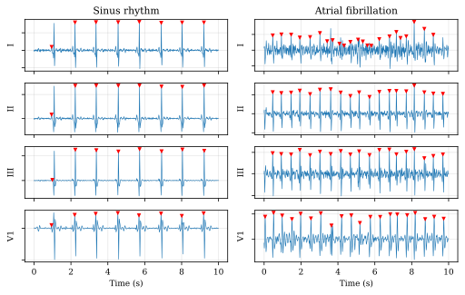
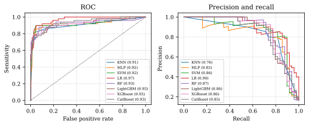
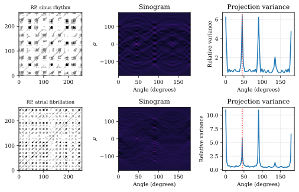
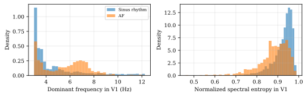
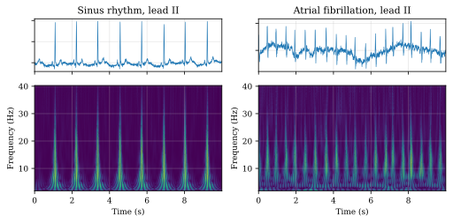
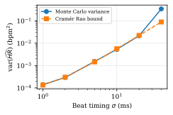
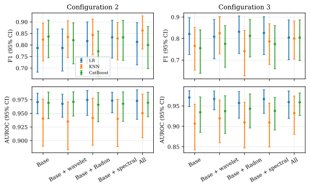

# Atrial Fibrillation Detection in Intensive Care ECGs

Reproduction of the handcrafted feature benchmark of Nassar et al. (arXiv:2512.18031) and an explainable extension with wavelet, Radon, spectral, and Cramér Rao analysis.

**Author:** Ricardo A. Acuña-Villogas, Department of Data Science, Universidad de Ingeniería y Tecnología (UTEC), Lima, Peru.
Final project of EL5308 Biological Signals, 2026. Full report: [informe/report.pdf](informe/report.pdf).

## Motivation

Atrial fibrillation (AF) is the most frequent arrhythmia in the intensive care unit (ICU), where noise, patient motion, and a reduced set of leads make automatic detection harder than in clinical 12 lead ECGs. Nassar et al. released the first public ICU AF dataset and benchmarks, but without source code. This project rebuilds their feature based benchmark from the text alone and then asks which signal processing features help, and why.

## Data

| Source | Recordings | AF prevalence | Use |
|---|---|---|---|
| PhysioNet/CinC 2021 (Chapman, Ningbo, CPSC, Georgia, PTB XL) | 70,203 | 0.18 | Training in configuration 3 |
| Kingston ICU AF dataset | 596 (298 train, 298 test, 49 AF in test) | 0.17 | Training in configuration 2, test in both |

Four leads are used (I, II, III, V1), resampled to 240 Hz and band pass filtered between 5 and 30 Hz.

## Method

1. **Reproduction.** 27 NeuroKit2 features per lead (RR statistics, HRV, Poincaré descriptors, entropy, P wave amplitude) feed eight classifiers: KNN, MLP, SVM, LR, RF, LightGBM, XGBoost, and CatBoost.
2. **Extension.** 16 more features per lead, for a total of 172:
   * discrete wavelet subband energies and Haar energies of the RR series;
   * Radon projections of the recurrence plot;
   * dominant frequency, organization index, and spectral entropy of the atrial residual after QRST cancellation.
3. **Analysis.** Cramér Rao bound of heart rate estimation, an ablation study with paired bootstrap intervals, and SHAP explanations.

## Results

**The reproduction matches the paper.** Across 16 model and configuration pairs, the largest AUROC deviation is 0.02 and the mean F1 deviation is 0.02, the effect of one or two misclassified episodes. Logistic regression is the only model that keeps its AUROC (0.97) when trained on public data and tested in the ICU.

**The Radon kurtosis at 45 degrees is the best single feature.** In sinus rhythm the recurrence plot has long periodic diagonals; in AF only the main diagonal survives, so the 45 degree projection becomes a single sharp peak. Its univariate AUROC (0.92 public, 0.95 ICU) is higher than that of pNN50 and stays stable across domains.

**The atrial spectrum shows the f waves.** After QRST cancellation, V1 shows a dominant frequency between 5 and 8 Hz in AF (median 5.75 Hz), which corresponds to 300 to 480 atrial activations per minute.

**Wavelets help visually more than as features.** Scaleograms show irregular QRS columns and low frequency f wave energy in AF. The DWT energies of the 5 to 30 Hz signal, however, separate the classes poorly, because the filter removes most of the f wave band.

**Mean heart rate carries little information.** Least squares heart rate estimation attains the Cramér Rao bound up to 20 ms of beat jitter, with an error of about 0.15 beats per minute. The diagnostic information lies in the irregularity of the intervals, not in the mean rate.

**Extended features help under domain shift.** With public training, all 172 features raise the AUROC of CatBoost from 0.935 to 0.959 and of KNN from 0.907 to 0.932, with paired bootstrap intervals that exclude zero. No F1 change is significant with 49 positive test cases.

**The models follow clinical criteria.** SHAP ranks the absent P wave first, then atrial activity (dominant frequency, spectral entropy, Radon kurtosis). By group, base features account for 57% of the attribution, spectral 18%, wavelet 13%, and Radon 12%. The P wave feature loses discriminative power in the ICU, which explains part of the degradation under domain shift.

## Repository layout

| Path | Content |
|---|---|
| pipeline.sh | Full resumable pipeline: downloads, labeling, features, experiments, notebook |
| scripts/ | Download, labeling, feature extraction (rasgos.py), and experiments |
| reproduccion_fa_uci.ipynb | Main notebook (Spanish) |
| informe/ | IEEE report (report.tex, report.pdf) and vector figures (figuras_en) |
| propuesta/ | One page project proposal |
| resultados/ | Metrics, ablation intervals, Cramér Rao table, SHAP groups |
| docs/figures/ | SVG figures for this README |
| requirements.txt | Pinned Python dependencies |

## How to run

1. Create the environment with the pinned dependencies:

       python3 -m venv .venv && .venv/bin/pip install -r requirements.txt
2. Download the Kingston ICU AF dataset from PhysioNet (credentialed access) into data/kingston-icu-af-dataset-1.0.0. The public data are downloaded by the pipeline.
3. Run the pipeline from the project folder:

       nohup setsid bash pipeline.sh > logs/pipeline_stdout.log 2>&1 &

The pipeline can be interrupted at any time and resumes from its checkpoints when relaunched. Progress is logged in logs/pipeline.log and metrics are written to resultados/metricas.csv.

## Data availability

The Kingston ICU AF dataset is distributed by PhysioNet under a credentialed data use agreement and is not included in this repository. The PhysioNet/CinC 2021 data are openly available.

## Reference

S. Nassar, N. Maghsoodi, S. Mannina, S. Addas, S. Sibley, G. Fichtinger, D. Pichora, D. Maslove, P. Abolmaesumi, and P. Mousavi, "A dataset and benchmarks for atrial fibrillation detection from electrocardiograms of intensive care unit patients," arXiv:2512.18031, 2025.
